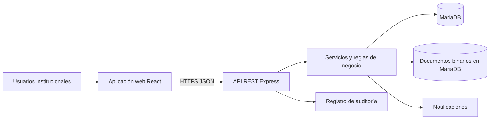
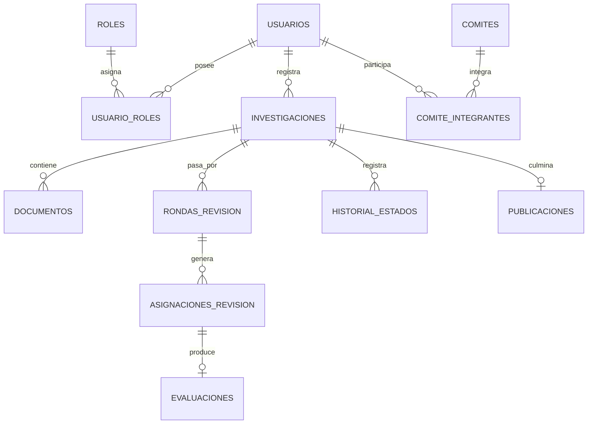
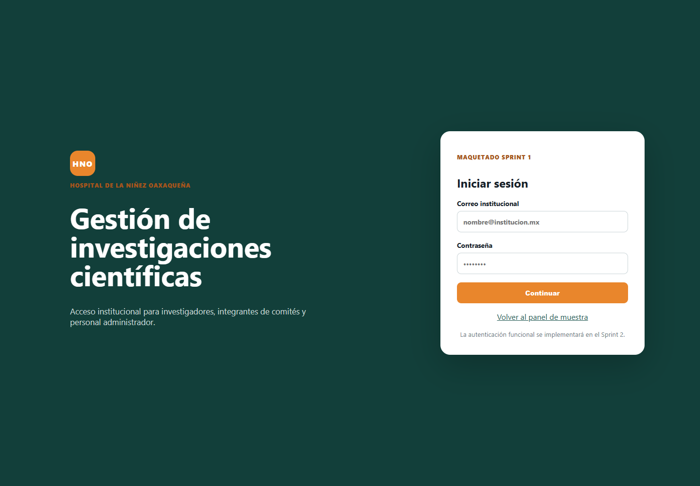
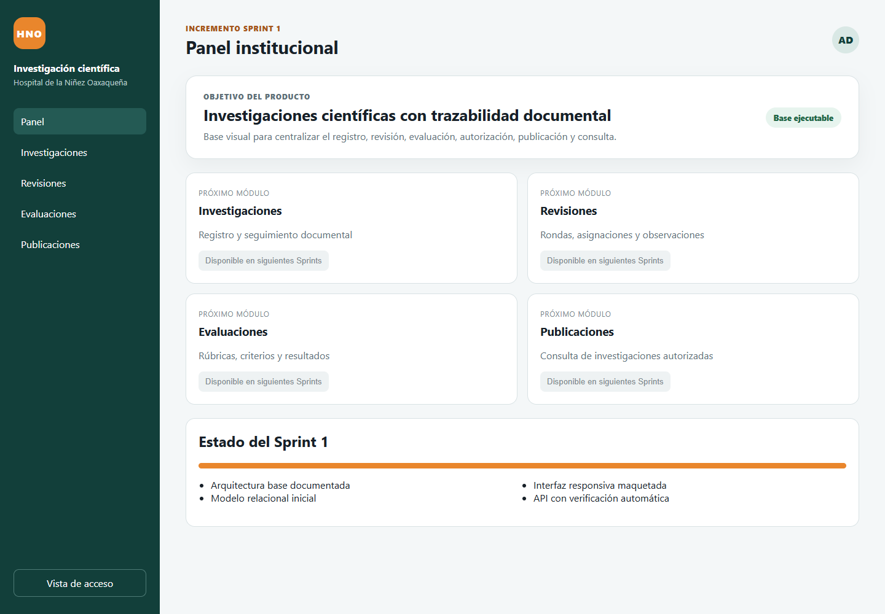
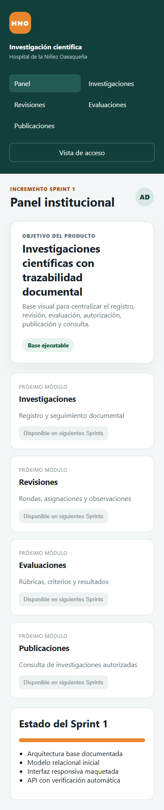
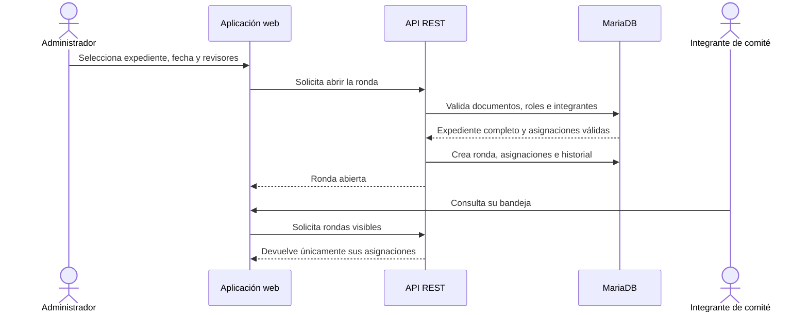
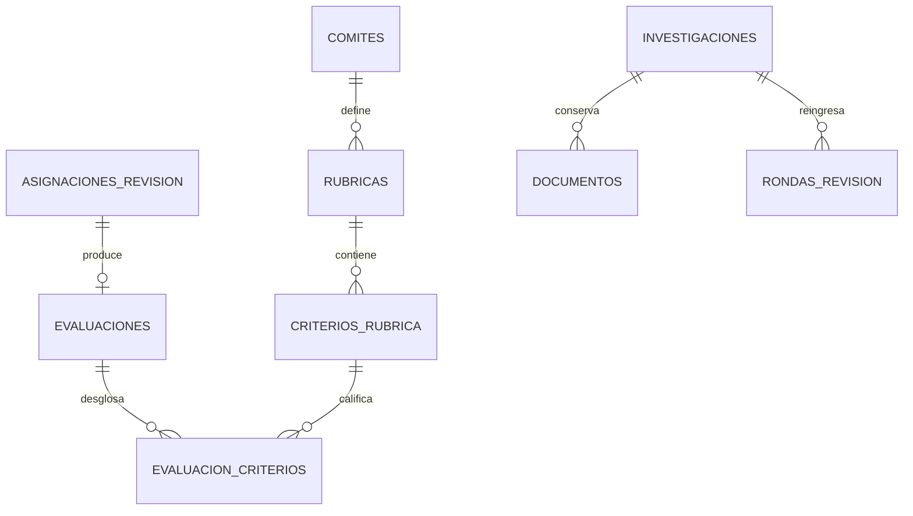

# CAPÍTULO IV DESARROLLO

## 4.1 Organización del desarrollo con Scrum

El desarrollo del sistema web se organizará mediante ocho Sprints de dos semanas. El representante que designe el Hospital de la Niñez Oaxaqueña actuará como Product Owner; su nombre permanece por definir. Santiago González Diego participa como Scrum Master y Developer, mientras que Romero Reyes Mario Jersain participa como Developer. Cada Sprint comienza con Sprint Planning, mantiene seguimiento mediante Daily Scrum y concluye con Sprint Review y Sprint Retrospective.

Las historias de usuario se emplean como formato para expresar necesidades del Product Backlog. Las tarjetas CRC no se incorporan porque pertenecen principalmente a prácticas de diseño utilizadas en XP y no constituyen un artefacto de Scrum. Las responsabilidades de clases y componentes se documentan mediante el diagrama de arquitectura, el modelo de datos y la estructura modular del código.

### 4.1.1 Objetivo del Producto

Centralizar el registro, revisión, evaluación, autorización, publicación y consulta de investigaciones científicas del Hospital de la Niñez Oaxaqueña, conservando la trazabilidad de documentos, versiones, asignaciones, observaciones, decisiones y estados del proceso.

### 4.1.2 Product Backlog inicial

El Product Backlog inicial contiene 26 elementos ordenados por valor, dependencia y riesgo. Los primeros elementos establecen la base técnica; los posteriores desarrollan autenticación, administración, gestión documental, revisiones, evaluación, autorización y publicación. La lista completa se conserva en `docs/product-backlog.md` y podrá refinarse con el Product Owner sin modificar el Objetivo del Producto.

| Sprint | Semanas | Resultado previsto |
|---|---:|---|
| 1 | 1 y 2 | Objetivo del Producto, backlog inicial, arquitectura, modelo de datos, interfaz base y aplicación ejecutable. |
| 2 | 3 y 4 | Autenticación, autorización por roles, usuarios, comités y catálogos. |
| 3 | 5 y 6 | Registro de investigaciones, anexos, PDF y control de versiones. |
| 4 | 7 y 8 | Rondas de revisión y asignación de integrantes de comités. |
| 5 | 9 y 10 | Rúbricas, evaluaciones, observaciones, correcciones y nuevas versiones. |
| 6 | 11 y 12 | Votación, historial de estados, notificaciones y autorización. |
| 7 | 13 y 14 | Publicación, consulta, integración y pruebas de aceptación. |
| 8 | 15 y 16 | Estabilización, despliegue, manuales, capacitación y entrega. |

## 4.2 Sprint 1 Base del producto

### 4.2.1 Sprint Planning

**Objetivo del Sprint:** establecer una base técnica, visual y documental ejecutable que permita desarrollar los módulos funcionales posteriores sin rehacer la arquitectura ni el modelo de información.

**Duración prevista:** semanas 1 y 2, del 25 de enero al 5 de febrero de 2027.

**Capacidad del equipo:** dos Developers durante diez días hábiles. La estimación es inicial y deberá ajustarse con la velocidad observada.

| ID | Elemento seleccionado | Prioridad | Puntos | Evidencia del incremento |
|---|---|---:|---:|---|
| HU-01 | Objetivo del Producto y Product Backlog | Alta | 3 | Backlog ordenado con 26 elementos. |
| HU-02 | Arquitectura modular | Alta | 5 | Diagrama de componentes y estructura de carpetas. |
| HU-03 | Modelo relacional y documental | Alta | 8 | Diagrama entidad relación y esquema MariaDB. |
| HU-04 | Interfaz base responsiva | Alta | 5 | Maquetado de acceso, navegación y panel. |
| HU-05 | Base técnica del proyecto | Alta | 5 | Monorepositorio con React, Express y configuración. |
| HU-06 | Base ejecutable verificable | Alta | 3 | API de salud, metadatos, pruebas y compilación web. |

### 4.2.2 Historias de usuario del Sprint 1

#### HU-01 Objetivo del Producto y Product Backlog

**Como** Product Owner, **quiero** disponer de un Objetivo del Producto y un Product Backlog ordenado, **para** comunicar el valor esperado y decidir qué trabajo debe atenderse primero.

**Criterios de aceptación:** el objetivo describe el resultado institucional; el backlog incluye los módulos definidos en el anteproyecto; cada elemento tiene prioridad, estimación y Sprint previsto; el Product Owner puede reordenarlo.

#### HU-02 Arquitectura modular

**Como** responsable institucional del sistema, **quiero** una arquitectura modular, **para** que la interfaz, las reglas de negocio, la persistencia y los documentos puedan evolucionar de manera controlada.

**Criterios de aceptación:** se distinguen aplicación web, API REST, servicios, MariaDB y almacenamiento documental; las comunicaciones están identificadas; la estructura permite incorporar autenticación y módulos sin acoplarlos a la interfaz.

#### HU-03 Modelo relacional y documental

**Como** administrador, **quiero** que la información se organice mediante entidades y relaciones consistentes, **para** conservar usuarios, investigaciones, versiones, revisiones, evaluaciones y publicaciones con trazabilidad.

**Criterios de aceptación:** existen claves primarias y foráneas; una investigación admite múltiples documentos y rondas; se controlan versiones documentales; se registran asignaciones, evaluaciones, estados y publicaciones.

#### HU-04 Interfaz base responsiva

**Como** usuario institucional, **quiero** una interfaz clara y adaptable, **para** reconocer los módulos disponibles y trabajar desde equipos con diferentes tamaños de pantalla.

**Criterios de aceptación:** se dispone de maquetado para acceso y panel; la navegación presenta Investigaciones, Revisiones, Evaluaciones y Publicaciones; el contenido se adapta a pantallas menores de 800 píxeles; las funciones futuras se identifican sin simular que ya están operativas.

#### HU-05 Base técnica del proyecto

**Como** Developer, **quiero** un repositorio organizado con aplicaciones separadas, **para** integrar cambios de forma frecuente y mantener responsabilidades claras.

**Criterios de aceptación:** existe una aplicación React, una API Express, scripts comunes, variables de entorno de ejemplo, esquema SQL y documentación; los secretos no se almacenan en el repositorio.

#### HU-06 Base ejecutable verificable

**Como** administrador técnico, **quiero** comprobar la disponibilidad y configuración inicial del sistema, **para** detectar fallos antes de incorporar módulos funcionales.

**Criterios de aceptación:** la API responde a `/api/health`; publica el Objetivo del Producto y los roles iniciales; las rutas inexistentes devuelven un error controlado; la aplicación web compila sin errores.

### 4.2.3 Diseño

#### 4.2.3.1 Arquitectura del sistema



La aplicación web concentra presentación y navegación. La API aplica autenticación, autorización y reglas del proceso. En el incremento local, MariaDB conserva tanto los datos estructurados como el contenido binario de los documentos, junto con sus metadatos y número de versión. Una política posterior podrá trasladar los archivos a almacenamiento institucional sin perder la trazabilidad registrada.

#### 4.2.3.2 Modelo de datos inicial



El esquema implementado incluye roles, usuarios, comités, integrantes, investigaciones, documentos versionados, rondas, asignaciones, rúbricas, criterios, evaluaciones, historial y publicaciones. La tabla `documentos` conserva nombre, tipo MIME, tamaño, versión, vigencia, responsable, fecha y contenido binario. Esta decisión permite verificar la persistencia completa durante el desarrollo local.

#### 4.2.3.3 Maquetado de vistas

El maquetado inicial contiene dos vistas. La vista de acceso presenta identidad institucional, correo, contraseña y aviso de que la autenticación funcional pertenece al Sprint 2. El panel base incorpora menú lateral, identificación del incremento, Objetivo del Producto y accesos visuales a Investigaciones, Revisiones, Evaluaciones y Publicaciones. Los botones de módulos futuros permanecen deshabilitados para que el prototipo no comunique funciones inexistentes.



*Figura 1. Maquetado inicial de la vista de acceso. Fuente: elaboración propia.*



*Figura 2. Maquetado inicial del panel institucional. Fuente: elaboración propia.*



*Figura 3. Comprobación del panel en una ventana móvil de 390 píxeles. Fuente: elaboración propia.*

### 4.2.4 Codificación

Se creó un monorepositorio con `apps/web` y `apps/api`. La interfaz utiliza React y Vite; la API utiliza Node.js y Express. El archivo `database/schema.sql` define la primera versión del modelo MariaDB. La API ofrece endpoints de salud y metadatos que permiten verificar la base sin anticipar las funciones del Sprint 2.

```text
sistema_investigaciones_hno/
├── apps/
│   ├── api/src y api/test
│   └── web/src
├── database/schema.sql y seed.sql
├── docs/
├── package.json
└── pnpm-workspace.yaml
```

### 4.2.5 Pruebas del incremento

| Código | Historia | Comprobación | Resultado esperado |
|---|---|---|---|
| PA-01 | HU-02 | Revisar el diagrama y la separación de componentes. | Presentación, servicios, persistencia y documentos se distinguen y relacionan. |
| PA-02 | HU-03 | Revisar entidades, claves y relaciones del esquema SQL. | El modelo soporta versiones, rondas, asignaciones, evaluación e historial. |
| PA-03 | HU-04 | Compilar la interfaz y revisar acceso, panel y adaptación móvil. | Las vistas compilan, muestran la navegación y se reorganizan en pantalla reducida. |
| PA-04 | HU-06 | Solicitar `/api/health`. | Respuesta 200 con estado `ok`, servicio y versión. |
| PA-05 | HU-06 | Consultar Objetivo del Producto y roles. | La API devuelve el objetivo y los cuatro perfiles iniciales. |
| PA-06 | HU-06 | Solicitar una ruta inexistente. | Respuesta 404 con mensaje controlado. |

**Resultado de la verificación preliminar:** se ejecutó `pnpm check` el 7 de octubre de 2026. Las cuatro pruebas automatizadas de la API finalizaron correctamente y la aplicación web generó su compilación de producción sin errores. En la ejecución formal del Sprint deberán repetirse estas pruebas y agregarse las evidencias de aceptación del Product Owner.

| Verificación ejecutada | Resultado |
|---|---|
| Estado de la API | Aprobada |
| Publicación del Objetivo del Producto | Aprobada |
| Catálogo inicial de cuatro roles | Aprobada |
| Respuesta controlada para rutas inexistentes | Aprobada |
| Compilación de producción de la interfaz React | Aprobada |

### 4.2.6 Sprint Review y Sprint Retrospective

En la Sprint Review se demostrará la navegación, el endpoint de salud, el Product Backlog, la arquitectura y el modelo de datos. El Product Owner deberá confirmar que los roles, comités, estados y documentos representan el proceso institucional. En la Sprint Retrospective los residentes revisarán la coordinación del repositorio, el tamaño de las historias, los impedimentos y la Definición de Terminado antes de comenzar el Sprint 2.

## 4.3 Sprint 2 Autenticación y administración inicial

**Objetivo propuesto:** permitir el acceso seguro y la administración inicial de usuarios, roles, comités y catálogos institucionales.

| ID | Historia de usuario | Puntos | Dependencia |
|---|---|---:|---|
| HU-07 | Como usuario, quiero iniciar y cerrar sesión para acceder de forma segura. | 8 | HU-05 |
| HU-08 | Como administrador, quiero aplicar permisos por rol para limitar cada función. | 8 | HU-07 |
| HU-09 | Como administrador, quiero crear, editar, activar y desactivar usuarios. | 8 | HU-08 |
| HU-10 | Como administrador, quiero gestionar comités e integrantes. | 8 | HU-09 |
| HU-11 | Como administrador, quiero gestionar catálogos institucionales. | 5 | HU-08 |

El incremento implementa el inicio y cierre de sesión, tokens con vigencia limitada y autorización por roles. La interfaz del administrador incorpora el módulo **Usuarios y permisos**, desde el cual se registran cuentas con nombre, correo, contraseña temporal y uno o varios roles. También permite activar o desactivar cuentas, modificar roles y restablecer contraseñas. Como reglas de seguridad, no se admiten correos repetidos, las contraseñas requieren al menos ocho caracteres, cada usuario debe conservar un rol y el administrador no puede desactivar su propia cuenta ni retirarse a sí mismo el rol administrativo.

Los usuarios se almacenan en `usuarios`, sus funciones se relacionan mediante `usuario_roles` y las contraseñas se conservan como hashes generados con bcrypt. Los servicios iniciales de comités y catálogos existen en la API, pero sus pantallas completas todavía no forman parte de este incremento. Esta precisión evita presentar como terminadas funciones que todavía no pueden operarse desde la interfaz.

La cabecera del menú lateral utiliza una franja blanca para conservar la legibilidad del logotipo institucional; el resto del menú mantiene el color vino y los controles se adaptan cuando la navegación se contrae.

## 4.4 Sprint 3 Registro y gestión documental

### 4.4.1 Sprint Planning

El Objetivo del Sprint consiste en permitir el registro inicial de investigaciones científicas y organizar sus documentos mediante plantillas, tipos documentales y versiones. El proyecto recibió los anexos A, E, G e I en formato Word, correspondientes a la ficha de registro, la elaboración del protocolo, la carta compromiso individual y el consentimiento informado. El Sprint comprende HU-12, HU-13 y HU-14, con 24 puntos estimados, y corresponde a las semanas 5 y 6, del 22 de febrero al 5 de marzo de 2027.

### 4.4.2 Historias de usuario

- **HU-12 Registrar y actualizar investigaciones.** Como investigador, quiero registrar los datos generales de una investigación y actualizar el borrador para mantener un expediente identificable.
- **HU-13 Descargar plantillas y cargar anexos.** Como investigador, quiero descargar los formatos disponibles y cargar anexos o el PDF de la investigación para reunir la documentación del expediente.
- **HU-14 Conservar versiones documentales.** Como responsable institucional, quiero conservar cada versión y distinguir la vigente para mantener trazabilidad sin sobrescribir antecedentes.

### 4.4.3 Diseño del incremento

El módulo se divide en lista de expedientes, búsqueda y filtro por estado, formulario de registro y edición del borrador, identificación del investigador responsable, detalle de la investigación, indicador de integración documental, carga de archivos, historial de versiones y plantillas descargables. Cuando un investigador registra un expediente, el sistema lo asigna automáticamente como responsable. Los perfiles Administrador y Administrador Investigador seleccionan al responsable entre las cuentas activas de investigación. Los investigadores consultan solamente sus propios expedientes; los dos perfiles administrativos consultan todos los registros del almacén de desarrollo.

Cada documento conserva tipo, nombre original, formato, tamaño, número de versión, usuario responsable, fecha y condición de vigencia. Cuando se carga una nueva versión del mismo tipo documental, la anterior permanece en el historial y deja de marcarse como vigente. El indicador de integración muestra cuáles de los anexos A, E, G e I y el PDF principal se encuentran vigentes. La investigación principal exige formato PDF; los demás tipos admiten PDF, DOC, DOCX, RTF u ODT; la API limita cada carga a 10 MB y solamente permite modificar o cargar documentos mientras el expediente permanece en borrador.

### 4.4.4 Codificación y estructura

La API incorpora operaciones para listar, registrar, consultar y actualizar investigaciones; consultar y cargar documentos; descargar archivos; listar plantillas y descargar cada formato. La interfaz incorpora navegación funcional hacia Investigaciones, formulario de borrador, edición de datos, búsqueda por título, área, categoría o responsable, filtro por estado, lista de documentos faltantes, carga mediante selector de archivo y consulta de versiones con responsable y fecha. El código fuente permanece en el repositorio y no se reproduce en este capítulo.

La ejecución normal utiliza MariaDB Server 11.4.10 mediante el conector `mariadb` para Node.js. La API crea un pool de conexiones, consulta usuarios y permisos, registra investigaciones y almacena el contenido de cada documento en la tabla `documentos`. El historial se conserva mediante registros separados por versión y una bandera de vigencia. El almacén en memoria queda limitado a las pruebas unitarias aisladas.

Para facilitar la ejecución en Windows se incorporó un instalador portátil que descarga el paquete oficial, verifica su suma SHA-256, inicializa el directorio de datos, aplica `schema.sql` y carga `seed.sql`. MariaDB se inicia con `pnpm db:up` y se detiene con `pnpm db:down`; los datos permanecen en `.runtime/data` después de reiniciar la API.

### 4.4.5 Pruebas del incremento

La verificación automatizada comprende autenticación obligatoria, consulta y asignación de responsables activos, registro y actualización de borradores, visibilidad por propietario, listado de plantillas, descarga de formatos, rechazo de archivos no PDF para la investigación principal, rechazo de extensiones no permitidas, carga de dos versiones, identificación de una sola versión vigente y descarga del contenido registrado. El conjunto unitario alcanza 18 pruebas aprobadas, sin fallos, además de la compilación de producción. Una prueba de integración adicional se ejecuta contra MariaDB y confirma que la investigación y las versiones documentales permanecen almacenadas y pueden recuperarse.

### 4.4.6 Sprint Review y Sprint Retrospective

En la Sprint Review se deben demostrar el registro de un expediente, la consulta de investigaciones según el rol, la descarga de los anexos A, E, G e I, la carga de un anexo, la carga del PDF y la sustitución controlada de una versión. La aceptación institucional permanece pendiente hasta que el Product Owner confirme que los documentos recibidos son las versiones vigentes y aplicables al hospital.

Para la retrospectiva se registran tres acciones: preparar respaldos periódicos de MariaDB, controlar futuras actualizaciones de los anexos proporcionados y acordar con el hospital la política definitiva de tamaño, formato y conservación de archivos.

## 4.5 Sprint 4 Rondas de revisión y asignaciones

### 4.5.1 Sprint Planning

El Objetivo del Sprint consiste en establecer un mecanismo trazable para abrir una ronda de revisión, asignar integrantes de los comités y consultar responsables, estados y vencimientos. El Sprint corresponde a las semanas 7 y 8, del 8 al 19 de marzo de 2027. Se seleccionaron 13 puntos del Product Backlog, distribuidos entre HU-15 y HU-16. La capacidad se definió para dos Developers durante diez días hábiles; el Daily Scrum se realizará en un máximo de quince minutos para inspeccionar avance, trabajo siguiente e impedimentos.

| ID | Elemento seleccionado | Prioridad | Puntos | Evidencia del incremento |
|---|---|---:|---:|---|
| HU-15 | Crear rondas y asignar revisores. | Alta | 8 | Formulario de apertura, integración de comités y asignaciones persistentes. |
| HU-16 | Consultar asignaciones y vencimientos. | Alta | 5 | Bandeja por rol, fechas límite, estado y avance de la ronda. |

La Definición de Terminado aplicada exige que la función opere desde la interfaz, aplique permisos en la API, persista en MariaDB, disponga de validaciones de negocio, incluya pruebas automatizadas y pueda demostrarse sin errores de compilación. La aceptación institucional permanece sujeta a la Sprint Review con el Product Owner.

### 4.5.2 Historias de usuario

#### HU-15 Crear rondas y asignar revisores

**Como** Administrador o Administrador Investigador, **quiero** abrir una ronda y asignar integrantes de los comités, **para** distribuir formalmente la revisión de un expediente completo.

**Criterios de aceptación:** la investigación debe permanecer en borrador; los anexos A, E, G e I y la investigación en PDF deben encontrarse vigentes; la fecha límite debe ser posterior a la fecha actual; cada asignación debe corresponder a un usuario activo con rol Comité e integrante del comité seleccionado; no se permiten asignaciones repetidas; al abrir la primera ronda, la investigación cambia a En revisión y el cambio queda registrado en el historial.

#### HU-16 Consultar asignaciones y vencimientos

**Como** integrante de comité, **quiero** consultar únicamente las revisiones que me fueron asignadas, **para** conocer el expediente, el comité, la fecha límite y el estado del trabajo.

**Criterios de aceptación:** el integrante ve exclusivamente sus asignaciones; el investigador responsable conoce el número de asignaciones y el avance sin conocer la identidad individual del revisor; los perfiles administrativos visualizan el detalle completo; una asignación puede pasar de Pendiente a En proceso, pero una asignación completada no puede reabrirse manualmente; la ronda muestra revisiones completadas respecto del total.

### 4.5.3 Análisis, diseño y maquetado

El flujo comienza cuando el responsable administrativo selecciona un expediente en borrador. La API verifica la integración documental antes de crear la ronda, con lo que se evita remitir expedientes incompletos. Después se eligen los integrantes a partir de la relación entre usuarios y comités y se define una fecha límite. La apertura genera registros en `rondas_revision` y `asignaciones_revision`, actualiza el estado de la investigación y agrega una entrada a `historial_estados` dentro de una transacción.



La pantalla de Revisiones se compone de cinco partes: encabezado del Sprint; formulario para seleccionar investigación y vencimiento; selector de integrantes agrupados por comité; directorio para configurar la pertenencia de los revisores; y panel de seguimiento con estado, barra de avance y detalle permitido por el rol. La interfaz mantiene la identidad vino y blanco del hospital, usa etiquetas comprensibles y adapta las columnas a pantallas menores.

### 4.5.4 Codificación y persistencia

La API incorpora operaciones para listar revisores, actualizar integrantes de comités, listar y consultar rondas, abrir una ronda y marcar una asignación como En proceso. Las reglas se implementan tanto en el almacén de pruebas como en el adaptador de MariaDB. La autorización se aplica en el servidor: solamente los perfiles Administrador y Administrador Investigador abren rondas o modifican integrantes; los demás perfiles consultan únicamente la información que les corresponde.

En MariaDB se reutilizan `usuarios`, `roles`, `comites`, `comite_integrantes`, `investigaciones`, `documentos`, `rondas_revision`, `asignaciones_revision` e `historial_estados`. La operación de apertura usa una transacción para impedir rondas parciales: si falla una asignación, no se conserva ningún cambio. Como datos iniciales de comprobación se prepararon tres cuentas de comité, una para Ética, una para Investigación y una para Bioseguridad.

### 4.5.5 Pruebas de aceptación

#### PA-20 Apertura de una ronda con expediente completo

**Historia relacionada:** HU-15.  
**Condiciones de ejecución:** sesión de Administrador; investigación en borrador; anexos A, E, G e I y PDF vigentes; integrante de comité activo.  
**Pasos:** 1) ingresar a Revisiones; 2) seleccionar el expediente; 3) establecer una fecha futura; 4) seleccionar un integrante; 5) pulsar Abrir ronda.  
**Resultado esperado:** se crea la ronda número 1, la asignación queda Pendiente, la investigación cambia a En revisión y se registra el historial.  
**Evaluación técnica:** aprobada mediante prueba automatizada y ejecución contra MariaDB. Aceptación del Product Owner: pendiente.

#### PA-21 Rechazo de expediente incompleto

**Historia relacionada:** HU-15.  
**Condiciones de ejecución:** sesión administrativa e investigación que no contiene todos los documentos requeridos.  
**Pasos:** 1) seleccionar el expediente; 2) definir fecha y revisor; 3) intentar abrir la ronda.  
**Resultado esperado:** el sistema no crea la ronda e informa cuáles tipos documentales faltan.  
**Evaluación técnica:** aprobada por validación de servicio. Aceptación del Product Owner: pendiente.

#### PA-22 Visibilidad de asignaciones por rol

**Historia relacionada:** HU-16.  
**Condiciones de ejecución:** una ronda con un revisor asignado y cuentas activas de Administrador, Investigador e integrante de Comité.  
**Pasos:** 1) consultar la ronda con cada perfil; 2) comparar el detalle presentado.  
**Resultado esperado:** el administrador ve todas las asignaciones; el integrante solo la propia; el investigador observa el avance agregado sin identidad individual del revisor.  
**Evaluación técnica:** aprobada en las pruebas de API. Aceptación del Product Owner: pendiente.

#### PA-23 Inicio de una revisión

**Historia relacionada:** HU-16.  
**Condiciones de ejecución:** integrante autenticado y asignación Pendiente.  
**Pasos:** 1) abrir Revisiones; 2) localizar la asignación; 3) pulsar Iniciar revisión.  
**Resultado esperado:** la asignación cambia a En proceso y la ronda a En evaluación; una asignación completada no admite este cambio.  
**Evaluación técnica:** aprobada. Aceptación del Product Owner: pendiente.

### 4.5.6 Sprint Review y Sprint Retrospective

La Sprint Review está prevista para el 19 de marzo de 2027, con hora por definir con el Product Owner. Se demostrarán integración documental obligatoria, apertura de ronda, asignación por comité, bandeja del revisor y restricciones por rol. El Product Owner deberá confirmar si los tres comités y los plazos representan el proceso real del hospital.

En la Sprint Retrospective se identificaron como mejoras: conservar las reglas críticas en el servidor y no únicamente en la interfaz; ejecutar de forma transaccional la creación de rondas; y mantener separada la identidad del revisor frente al investigador. Como acción para el Sprint 5 se acordó calcular la calificación en la API y versionar las rúbricas para no alterar evaluaciones históricas.

## 4.6 Sprint 5 Rúbricas, evaluaciones y correcciones

### 4.6.1 Sprint Planning

El Objetivo del Sprint consiste en permitir que cada comité evalúe una asignación mediante criterios ponderados, registre observaciones y solicite correcciones que generen nuevas versiones documentales y una nueva ronda. El Sprint corresponde a las semanas 9 y 10 efectivas, del 5 al 16 de abril de 2027, después del receso académico del 22 de marzo al 2 de abril. Se seleccionaron HU-17, HU-18 y HU-19, con 24 puntos estimados.

| ID | Elemento seleccionado | Prioridad | Puntos | Evidencia del incremento |
|---|---|---:|---:|---|
| HU-17 | Configurar rúbricas y criterios. | Alta | 8 | Rúbrica versionada, criterios, ponderaciones y puntaje máximo. |
| HU-18 | Evaluar y registrar observaciones. | Alta | 8 | Captura por asignación y cálculo ponderado en el servidor. |
| HU-19 | Atender correcciones y nuevas versiones. | Alta | 8 | Observaciones, carga de correcciones y nueva ronda trazable. |

El alcance no incluye la autorización institucional definitiva, votación ni publicación. Esas decisiones pertenecen a los Sprints 6 y 7. En este incremento una recomendación favorable mantiene el expediente En revisión; una recomendación con correcciones o no favorable lo coloca Con observaciones, sin convertirla por sí misma en aprobación o rechazo definitivo.

### 4.6.2 Historias de usuario

#### HU-17 Configurar rúbricas y criterios

**Como** responsable administrativo, **quiero** crear una rúbrica para cada comité, **para** que las evaluaciones utilicen criterios y ponderaciones comunes.

**Criterios de aceptación:** la rúbrica pertenece a un comité activo; contiene al menos dos criterios; cada criterio tiene descripción, ponderación positiva y puntaje máximo; la suma de ponderaciones es exactamente 100%; al crear una versión nueva se desactiva la anterior sin borrarla; el integrante solo consulta rúbricas de los comités a los que pertenece.

#### HU-18 Evaluar y registrar observaciones

**Como** integrante de comité, **quiero** asignar puntajes y una recomendación a mi revisión, **para** comunicar un resultado verificable al responsable de la investigación.

**Criterios de aceptación:** solo el integrante asignado puede evaluar; se utiliza una rúbrica activa del mismo comité; todos los criterios reciben un puntaje dentro del máximo; la API calcula la calificación ponderada; se guarda recomendación y observación general; la asignación cambia a Completada; el investigador recibe la observación sin identidad individual del revisor.

#### HU-19 Atender correcciones y nuevas versiones

**Como** investigador responsable, **quiero** cargar versiones corregidas y reenviar el expediente, **para** responder a las observaciones sin perder el historial previo.

**Criterios de aceptación:** el expediente con observaciones vuelve a permitir edición y carga; la versión anterior permanece almacenada y deja de ser vigente; se exige al menos una versión mayor a uno antes del reenvío; la ronda anterior se cierra; la nueva ronda incrementa su número, conserva las asignaciones y establece un plazo de catorce días; el expediente vuelve a En revisión.

### 4.6.3 Análisis, diseño y modelo de datos

El cálculo de la evaluación se realiza en la API y no en el navegador. Para cada criterio se normaliza el puntaje respecto del máximo y se multiplica por la ponderación. La suma produce una calificación entre cero y cien. Esta decisión impide que un cliente modificado envíe una calificación final distinta de los criterios registrados.

```text
calificación = Σ ((puntaje obtenido / puntaje máximo) × ponderación)
```

Se agregó `evaluacion_criterios` para relacionar cada evaluación con los criterios y puntajes utilizados. La tabla evita guardar una calificación sin evidencia y permite reconstruir el resultado aun cuando posteriormente se cree otra versión de la rúbrica.



El maquetado de Evaluaciones se adapta al rol. El administrador dispone del formulario de rúbrica, contador de ponderación y editor dinámico de criterios. El integrante de comité recibe una bandeja de asignaciones, selector de rúbrica, campos de puntaje, recomendación y observación. El equipo de investigación consulta resultados agrupados por ronda y comité; cuando el expediente está Con observaciones aparece una instrucción para cargar las correcciones y el botón Enviar correcciones.

### 4.6.4 Codificación y reglas de negocio

La API permite listar y crear rúbricas, consultar o guardar la evaluación de una asignación, consultar observaciones por investigación y reenviar correcciones. La migración `002_sprints_4_5.sql` crea de forma idempotente el detalle de puntajes; por ello puede aplicarse tanto en una instalación nueva como en una base ya inicializada.

Las reglas centrales son: ponderación total igual a 100%; puntajes dentro de límites; evaluación exclusiva del revisor asignado; recomendación limitada a Sin correcciones, Con correcciones o No favorable para la ronda; ocultamiento de identidad individual en la vista del investigador; persistencia de versiones; y creación transaccional de la ronda de corrección. El código fuente se conserva en `apps/api/src`, `apps/web/src` y `database`; en el capítulo solamente se describe su estructura y responsabilidad.

### 4.6.5 Pruebas de aceptación

#### PA-24 Validación de la ponderación de una rúbrica

**Historia relacionada:** HU-17.  
**Condiciones de ejecución:** sesión administrativa y comité activo.  
**Pasos:** 1) capturar dos o más criterios; 2) asignar ponderaciones cuya suma sea distinta de 100%; 3) intentar guardar; 4) corregir la suma a 100% y guardar nuevamente.  
**Resultado esperado:** la primera solicitud se rechaza con un mensaje claro; la segunda crea una versión activa y conserva las versiones anteriores como inactivas.  
**Evaluación técnica:** aprobada. Aceptación del Product Owner: pendiente.

#### PA-25 Cálculo ponderado de la evaluación

**Historia relacionada:** HU-18.  
**Condiciones de ejecución:** integrante de comité con asignación y rúbrica activa de dos criterios, ponderados en 40% y 60%, ambos con máximo de diez.  
**Pasos:** 1) registrar puntajes de 8 y 9; 2) seleccionar Con correcciones; 3) escribir la observación; 4) guardar.  
**Resultado esperado:** la API calcula 86 puntos, conserva el detalle por criterio, completa la asignación y cambia el expediente a Con observaciones.  
**Evaluación técnica:** aprobada en memoria y MariaDB. Aceptación del Product Owner: pendiente.

#### PA-26 Protección de la evaluación por responsable

**Historia relacionada:** HU-18.  
**Condiciones de ejecución:** una asignación perteneciente a un integrante y una segunda cuenta autenticada.  
**Pasos:** 1) intentar evaluar con la segunda cuenta; 2) repetir con el integrante asignado.  
**Resultado esperado:** el primer intento devuelve acceso denegado; el segundo permite guardar la evaluación.  
**Evaluación técnica:** aprobada mediante autorización del servidor. Aceptación del Product Owner: pendiente.

#### PA-27 Consulta confidencial de observaciones

**Historia relacionada:** HU-18.  
**Condiciones de ejecución:** evaluación completada e investigador responsable autenticado.  
**Pasos:** 1) seleccionar la investigación en Evaluaciones; 2) revisar calificación, comité, criterios y observación.  
**Resultado esperado:** se presenta la observación y su desglose sin nombre, correo o identificador del revisor individual.  
**Evaluación técnica:** aprobada. Aceptación del Product Owner: pendiente.

#### PA-28 Reenvío de correcciones

**Historia relacionada:** HU-19.  
**Condiciones de ejecución:** investigación Con observaciones y ronda previa con asignaciones.  
**Pasos:** 1) intentar reenviar sin cargar una corrección; 2) cargar una nueva versión de un documento; 3) pulsar Enviar correcciones.  
**Resultado esperado:** el primer intento se rechaza; después de cargar la versión se cierra la ronda anterior, se crea la siguiente ronda con las mismas asignaciones y el expediente vuelve a En revisión.  
**Evaluación técnica:** aprobada en memoria y MariaDB. Aceptación del Product Owner: pendiente.

### 4.6.6 Resultados de verificación

La verificación técnica actualizada al 5 de noviembre de 2026 obtuvo 21 pruebas unitarias y de API aprobadas, tres pruebas de integración aprobadas contra MariaDB 11.4.10 y una compilación de producción de React sin errores. La prueba integral cubre registro del expediente, cinco tipos documentales obligatorios, apertura de ronda, restricción por rol, creación de rúbrica, evaluación ponderada, consulta confidencial, nueva versión, reenvío, dictamen, autorización, notificaciones, publicación y reporte. Estas evidencias demuestran funcionamiento técnico; no sustituyen la aceptación formal del Product Owner.

| Verificación | Resultado |
|---|---|
| 21 pruebas unitarias y de API | Aprobada |
| 3 pruebas de integración con MariaDB | Aprobada |
| Persistencia del detalle por criterio | Aprobada |
| Compilación de producción de React | Aprobada |
| Revisión visual de Administrador e integrante de Comité | Aprobada |
| Aceptación institucional del incremento | Pendiente de Sprint Review |

### 4.6.7 Sprint Review y Sprint Retrospective

La Sprint Review está prevista para el 16 de abril de 2027, con hora por definir con el Product Owner. La demostración debe incluir creación de una rúbrica, rechazo de ponderaciones inválidas, captura de puntajes, cálculo automático, consulta de observaciones, carga de una corrección y apertura de la ronda siguiente. El Product Owner deberá confirmar los criterios reales de cada comité y la terminología de las recomendaciones antes de utilizar el módulo en producción.

En la Sprint Retrospective se identificaron tres resultados positivos: las reglas se comparten entre pruebas y persistencia; el cálculo no depende de la interfaz; y la corrección conserva antecedentes en lugar de sobrescribirlos. Como acciones futuras se acordó no interpretar una recomendación como dictamen institucional, incorporar votación y autorización únicamente en el Sprint 6 y definir con el hospital la política de notificaciones.

## 4.7 Sprint 6. Dictamen, autorización y notificaciones

**Estado:** incremento implementado y verificado en el entorno local. La aceptación del Product Owner permanece pendiente.

El objetivo fue cerrar la evaluación institucional sin confundir la recomendación individual con la decisión del comité. El integrante de comité registra su evaluación; el Administrador o Administrador Investigador consulta el consolidado, registra el dictamen y autoriza la investigación cuando todas las decisiones son favorables. El sistema conserva historial y genera notificaciones para el responsable.

### 4.7.1 Historias y reglas implementadas

- **HU-20 Registrar dictamen por comité:** conserva comité, ronda, decisión, observaciones, responsable y fecha.
- **HU-21 Autorizar y notificar:** cambia el expediente a `APROBADA`, registra el historial y crea la notificación correspondiente.
- La autorización exige ronda cerrable, evaluaciones completas, dictámenes favorables y PDF vigente.
- El investigador puede consultar el historial y sus notificaciones, pero no la identidad individual de los revisores.

### 4.7.2 Estructura técnica

La API utiliza `GET /investigations/:id/decision-summary`, `POST /investigations/:id/committee-decisions`, `POST /investigations/:id/authorize`, `GET /investigations/:id/history` y las rutas de `/notifications`. MariaDB conserva `dictamenes_comite`, `historial_estados` y `notificaciones`; el estado `APROBADA` representa la autorización y evita duplicar la fuente de verdad.

### 4.7.3 Verificación

Las pruebas PA-31 a PA-34 comprobaron el registro del dictamen, los permisos, el bloqueo de una autorización incompleta y la transición válida a `APROBADA`. Todas fueron aprobadas técnica y persistentemente; la validación institucional continúa pendiente de la Sprint Review.

## 4.8 Sprint 7. Publicación, consulta y reporte ejecutivo

**Estado:** incremento implementado y verificado en el entorno local. La aceptación del Product Owner permanece pendiente.

El Sprint publica únicamente el documento `INVESTIGACION_PDF` vigente de una investigación aprobada. La API desactiva la publicación anterior, registra una sola versión activa, cambia el expediente a `PUBLICADA` y conserva historial y notificación. Los usuarios autenticados consultan publicaciones activas y descargan solo el PDF autorizado; los anexos y borradores permanecen protegidos.

### 4.8.1 Historias y alcance implementado

- **HU-23 Publicar una versión autorizada.**
- **HU-24 Consultar y descargar investigaciones publicadas.**
- **HU-27 Consultar el reporte ejecutivo.**
- El reporte presenta totales y distribuciones por estado, área y categoría, con filtros de fecha admitidos por la API.

### 4.8.2 Estructura y verificación

El flujo usa `POST /investigations/:id/publish`, `GET /publications`, la descarga protegida del documento publicado y `GET /reports/executive`. Las pruebas PA-35 a PA-39 validaron publicación, bloqueo de expedientes no aprobados, consulta, descarga, indicadores y protección de datos. El resultado consolidado es de 21 pruebas unitarias y de API, tres pruebas de integración con MariaDB y compilación de React aprobadas.

## 4.9 Sprint 8. Estabilización, despliegue y entrega

**Estado:** cierre técnico local completado; instalación y aceptación institucional pendientes.

Los Sprints 1 al 7 funcionan localmente. El Sprint 8 incorporó validación de configuración de producción, encabezados HTTP de seguridad, preparación reproducible, ejecución compilada, manual técnico, manual de usuario y respaldo y restauración con manifiesto SHA-256. El 8 de noviembre de 2026 se aprobaron 22 pruebas unitarias y de API, tres pruebas con MariaDB, la compilación de React y el ciclo de respaldo y restauración. La instalación en infraestructura del hospital, HTTPS, capacitación y acta de aceptación permanecen pendientes porque requieren recursos, credenciales y autorización institucionales.
